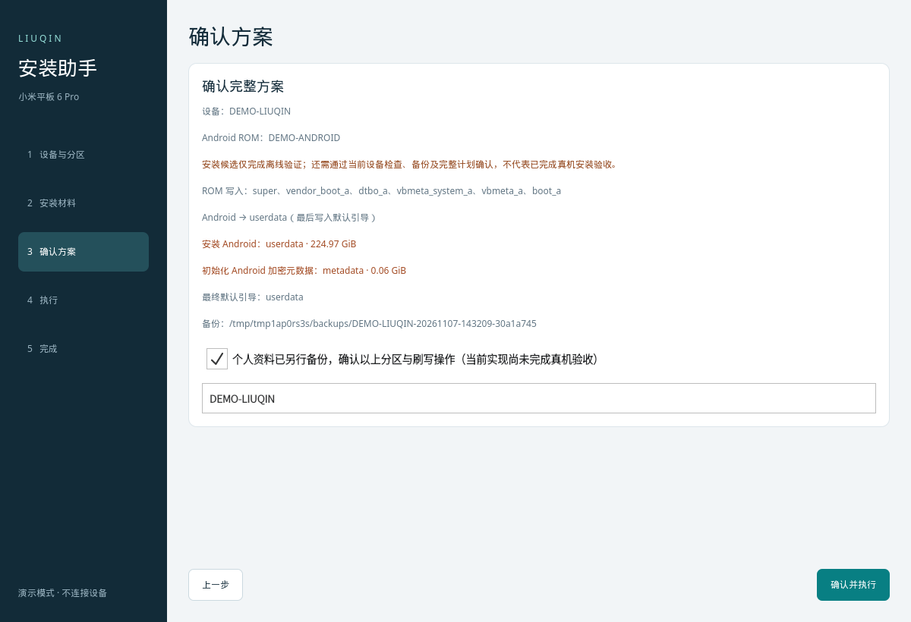

# Liuqin Linux Kit

面向 **小米平板 6 Pro（liuqin，SM8475）** 的 Linux 构建、设备适配与 Android/Linux 安装工具。默认从官方 Fedora 45 ARM64 基础系统构建 KDE Plasma，目标内核为 Linux 7.3.3。

[安装助手](docs/INSTALLER-GUI.md) · [构建指南](docs/BUILD.md) · [硬件支持](docs/HARDWARE.md) · [文档索引](docs/README.md)

本项目衍生自 **[yzddmr6/xiaomipad-6pro-mainline](https://github.com/yzddmr6/xiaomipad-6pro-mainline)**。原作者及第三方来源、署名和许可见 [CREDITS](CREDITS.md)、[LICENSE](LICENSE) 和 [NOTICE](NOTICE)。

## 支持范围

| 内容 | 当前实现 |
| --- | --- |
| 设备 | 仅 liuqin |
| 系统 | 一个 Android 加多个 Linux，可只装其中一种 |
| 目标内核 | Linux 7.3.3 + 板级适配 |
| 安装环境 | 自带内核的原生 Rec，通过 USB ADB 与电脑 GUI 配合 |
| 安装器 | 先读真实分区，再选系统材料；统一备份、方案确认、限定写入和回读 |
| 引导管理 | 电脑或具备相应能力的 Rec 切换默认系统；支持中断检查与重复引导快照回收 |
| 固定 Rec | A 槽固定、冷启动及恢复已验证；按设备与固件匹配镜像 |
| 内核升级 | 版本化 RPM/DEB；系统内自动写引导仍默认停用 |

固定 Rec 的跨 ROM 保护按安装后的启动链检查；已知硬件限制见对应专题。

日常硬件功能、睡眠和显示的已知限制见[硬件说明](docs/HARDWARE.md)。

## 使用安装器

电脑准备 uv、包含 ADB/Fastboot 的 Platform-Tools 和 USB 数据线。平板需已解锁；从 Bootloader Fastboot 临时启动配套 Rec，或先进入包内可验证的已固定 Rec。

```sh
uv run --project installer installer/install-gui.py
```

源码模式自动查找 `out/releases/native-recovery-flash/recovery.img` 等配套镜像；也可用 `--recovery-image /path/to/recovery.img` 明确选择。Windows 10/11 x64 可运行 `installer/start-windows.cmd`，只需相应 Fastboot/ADB 驱动，无需配置 USB 网卡。

五步流程为：设备与分区 → 安装材料 → 确认方案 → 执行 → 完成。勾选 userdata 安装 Android，勾选 rootfs 安装 Linux；新建、删除、格式化先加入待执行列表，确认后才写盘。Android 选择完整 ROM ZIP，Linux 选择配套 boot.img 与 rootfs.tar.gz。

**重装、删除和格式化会清除相应数据，工具的设备/引导备份不包含个人文件。** 完成后留在 Rec；首次启动由用户在平板确认。操作与恢复见[安装助手](docs/INSTALLER-GUI.md)和[安装要求与恢复](docs/FLASHING.md)。



## 构建 Linux 系统

在 Linux 主机准备 Devbox/Nix：

```sh
git clone https://github.com/wkai343/liuqin-linux-kit.git
cd liuqin-linux-kit
devbox install
devbox run doctor
devbox run init
devbox run fetch-rom
devbox run plan
devbox run build
devbox run outputs
```

检查本机 `build.json` 的内核、ROM 路径及 `rootfs_config`。`build` 生成配套 boot/rootfs；`outputs` 按内核/模块标识列出路径，boot 产物可复制为 `boot.img`。原生 ADB Rec 由 `build/recovery/` 独立构建。

rootfs 装配默认使用 Podman 用户命名空间，具备完整 subuid/subgid 等依赖后无需 sudo 密码。已有系统升级见[内核更新](docs/KERNEL-UPDATES.md)，更换源码或配置后需使用同批 Image、模块和 boot。

## 项目目录

| 目录 | 用途 |
| --- | --- |
| `build/` | 构建脚本、内核补丁、rootfs 配方、Rec 构建与验证工具 |
| `installer/` | 当前 QML 向导、worker、备份与源码打包 |
| `device/`、`shared/` | 板级适配、Rec/安装代理和共用接口 |
| `docs/`、`tests/` | 使用、开发与离线回归 |
| `inputs/`、`sources/`、`out/` | 素材、外部源码和构建产物，不提交 |

安装器源码包由 `python3 installer/package.py` 生成；内置 Rec 的交付包需另传入镜像及相应源码/许可。目录边界见[项目结构](docs/STRUCTURE.md)，工作流见[CI](docs/CI.md)，贡献要求见 [CONTRIBUTING](CONTRIBUTING.md)。[问题反馈](https://github.com/wkai343/liuqin-linux-kit/issues)。
