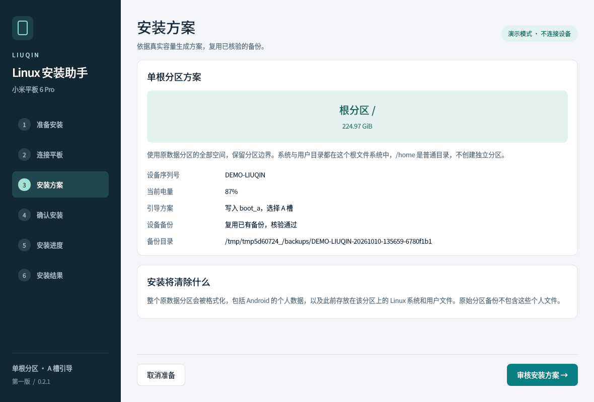

# Liuqin Linux Kit

面向 **小米平板 6 Pro（liuqin，SM8475）** 的 Linux 构建、设备适配与安装工具。
默认从官方 Fedora ARM64 基础系统构建 KDE Plasma，保留 Ubuntu Plasma 配方。

[构建指南](docs/BUILD.md) · [安装助手](docs/INSTALLER-GUI.md) · [硬件支持](docs/HARDWARE.md) · [文档索引](docs/README.md) · [问题反馈](https://github.com/wkai343/liuqin-linux-kit/issues)

本项目衍生自 **[yzddmr6/xiaomipad-6pro-mainline](https://github.com/yzddmr6/xiaomipad-6pro-mainline)**，
保留原作者的板级适配及第三方来源。署名和许可证见 [CREDITS](CREDITS.md)、[LICENSE](LICENSE) 和 [NOTICE](NOTICE)。

## 支持范围

| 内容 | 状态 |
| --- | --- |
| 设备 | 仅 Xiaomi Pad 6 Pro；256GB 已实测，128GB / 512GB 容量规划通过离线检查 |
| 系统 | Fedora 44 ARM64 + KDE Plasma，官方 Plasma Setup / Plasma Login；可选 Ubuntu 26.04 Plasma |
| 内核 | 默认安装 Linux 7.3 + Liuqin 设备适配；`installer.img` 自身临时运行 6.17，支持安装 7.3 系统，见 [内核说明](docs/KERNEL-7.3.md) |
| 定制 | 内核源码与配置、rootfs 软件增减、系统配置 overlay |
| 安装 | 单根 ext4 或 Btrfs，使用整个 userdata，从 A 槽启动 |
| 安装器 | QML 界面，独立备份、备份复用、方案确认、传输校验与引导回读 |
| 内核更新 | 版本化 RPM/DEB；系统内自动写引导尚未真机验收，默认停用 |

一台 256GB / HW16.9.0 设备已验证 Fedora 桌面、中文、Wi-Fi、HiFi 音频、自动旋转、
磁吸键盘平板模式、U 盘、电池显示、Adreno 监测、指纹锁屏及后摄；前摄未启用。
本机 256GB 已通过 Linux GUI 单根 Btrfs 安装、桌面启动与正常重启，Windows GUI 安装也已验证成功；其他容量仍待实测，见 [硬件说明](docs/HARDWARE.md)。

仍有偶发开机显示异常和待机提前唤醒；显示自动恢复可缓解故障，待机功耗尚无可靠结论。
当前限制与后续工作见 [待改进与验证](docs/DEVELOPMENT-STATUS.md)，CABC 用法见 [显示与画质](docs/DISPLAY.md)。

## 构建

在 Linux 主机安装 Devbox/Nix，然后运行：

```sh
git clone https://github.com/wkai343/liuqin-linux-kit.git
cd liuqin-linux-kit
devbox install
devbox run doctor
devbox run init-build
```

检查 `build.json` 中的内核与 ROM 路径，按需修改 `build/rootfs/fedora-plasma.json`：

```sh
devbox run fetch-rom
devbox run plan
devbox run build
```

成品在 `out/releases/fedora-plasma-<内容标识>/`：

| 文件 | 用途 |
| --- | --- |
| `installer.img` | 独立的临时安装环境 |
| `boot.img` | 平板系统引导与目标内核 |
| `rootfs.tar.gz` | 桌面系统、设备组件及配套模块 |

首次开机在平板上创建账号。分别构建、定制与缓存说明见 [构建指南](docs/BUILD.md)，
已有系统升级见 [内核更新](docs/KERNEL-UPDATES.md)。

## 安装

电脑需要 uv、Fastboot 和 USB 连接；平板需解锁 Bootloader 并进入 Fastboot。
在项目根目录运行，首次启动会准备 Python/Qt 环境：

```sh
uv run --project installer installer/install-gui.py
```

在界面选择三个文件所在目录，或添加 `--bundle /path/to/images`。
Windows 10/11 x64 可双击 `installer/start-windows.cmd`，驱动和 USB 网络配置见 [安装助手](docs/INSTALLER-GUI.md#windows-1011-使用)。

先选择或创建设备备份，再检查方案并确认安装。**首次安装和重装都会清空 userdata，设备备份不含个人文件。**
操作与恢复准备见 [安装助手](docs/INSTALLER-GUI.md)和[安装指南](docs/FLASHING.md)。



## 项目目录

| 目录 | 用途 |
| --- | --- |
| `build/` | 构建脚本、内核配置、rootfs 配方和 Devbox 环境 |
| `installer/` | GUI、CLI、备份管理与独立安装器源码打包 |
| `device/`、`shared/` | 设备适配与公共接口 |
| `docs/`、`tests/` | 文档与离线回归测试 |
| `inputs/`、`sources/`、`out/` | 本机素材、外部源码和产物，不提交 |

`python3 installer/package.py` 生成独立安装器源码包，镜像另行提供。
目录边界见 [项目结构](docs/STRUCTURE.md)，工作流见 [CI](docs/CI.md)，贡献要求见 [CONTRIBUTING](CONTRIBUTING.md)。
