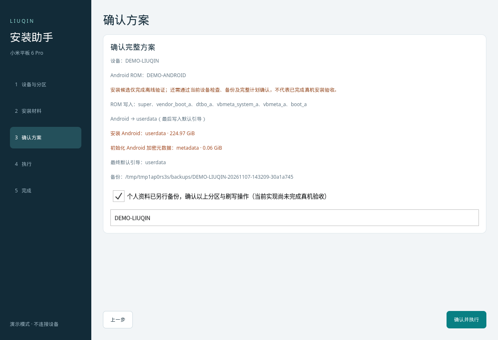
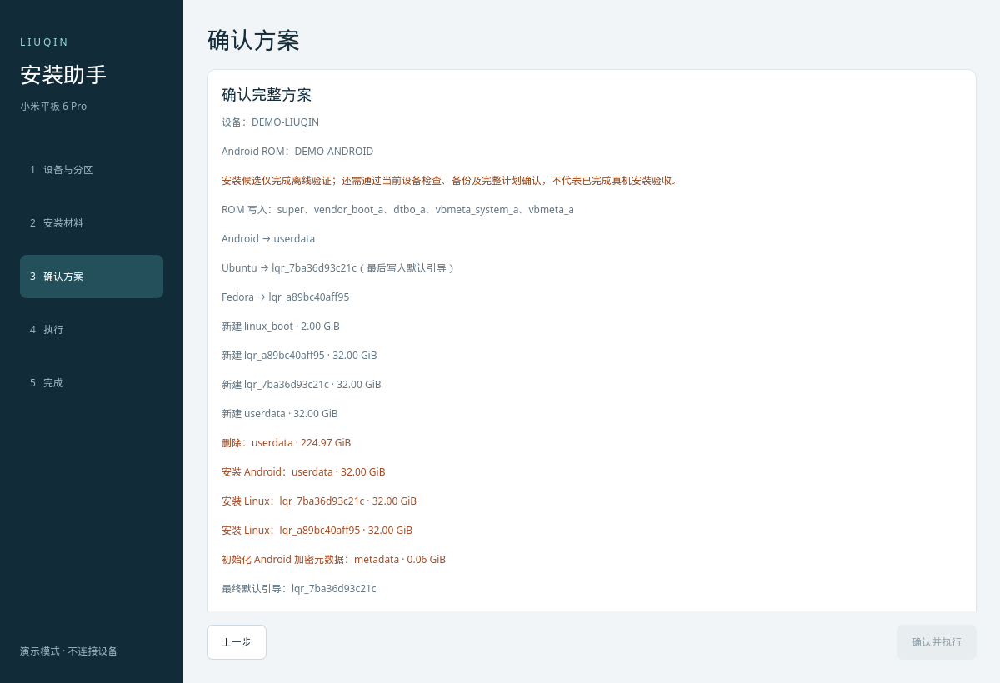

# 安装助手

[项目首页](../README.md) ｜ [备份与恢复](FLASHING.md)

当前五步 QML 向导支持 Linux、Windows 10/11 x64。先读取真实分区，再根据所选目标要求材料；Android 和 Linux 可分别或一起安装。

## 启动与运行环境

```sh
uv run --project installer installer/install-gui.py
```

连接后只读识别设备，不自动重启。平板需解锁 Bootloader，管理路径要求 A 槽。点击「读取分区」时，从 Bootloader Fastboot 临时启动配套原生 Rec，或连接已运行且有本地校验镜像的 Rec。兼容条件与实测范围以所选镜像的清单、随包 `STATUS.txt` 和验收记录为准。

源码模式优先查找 `out/releases/native-recovery-flash/recovery.img` 等默认运行镜像；内置镜像的交付包无需用户另找 Rec。也可明确选择：

```sh
uv run --project installer installer/install-gui.py --recovery-image /path/to/recovery.img
```

GUI 不需要旧 `installer.img`。运行环境与 Linux 的 `boot.img` 是不同镜像，电脑端按构建 ID、内核和运行载荷核验，不能只靠文件名匹配。

Android 中需开启 USB 调试并允许电脑；也可先手动进入 Bootloader Fastboot。普通/原厂 Recovery、fastbootd 与 Bootloader Fastboot 分开识别。ROM 名称和 Android 版本本身不证明启动兼容性。当前传输使用 USB ADB，不需要 USB 网卡、DHCP、Telnet 或网络共享。

## 五步流程

1. **设备与分区**：读取真实 GPT，勾选 userdata 安装 Android，勾选一个或多个 rootfs 安装 Linux。新建、删除、格式化先加入待执行列表，可以撤销。
2. **安装材料**：Android 选择完整 liuqin ROM；Linux 为每个目标选择配套 `boot.img` 和 `rootfs.tar.gz`。可指定本次安装的默认系统，或在条件允许时保留当前默认引导。
3. **确认方案**：核验全部材料、容量、系统/分区身份和备份，列出清除范围、ROM 写入、固定 Rec 保护和最终默认引导；确认后才允许写盘。
4. **执行**：按计划处理分区，逐个安装并回读所选系统，最后提交选定默认系统。联合计划的子任务不再逐个确认；任一步失败即停止并保留记录。
5. **完成**：操作后留在 Rec，不自动重启或切槽。用户再通过 Rec 电源菜单启动默认系统，并验证首次启动。

只装 Android 时只勾选 userdata，无需创建 Linux 或 linux_boot。只装 Linux 时无需 ROM；不选系统但有待执行分区操作时，下一步进入分区方案。未选系统继续保留，明确加入的删除/格式化操作仍会执行。





## 分区操作范围

- 新建分区只使用真实 GPT 空闲区或本次明确删除所释放的空间；不保留数据缩容、不移动相邻分区。
- 新建对话框按连续空间限制容量，计入已排队分区及引导存储。「使用所有未分配空间」使用最大的一段连续空闲区，并保留精确对齐容量。
- 重装或格式化所选 rootfs 会清空该系统及其 /home。格式化生成新文件系统身份，安装镜像随之重新绑定；其他系统不重新安装。
- 格式化 userdata 同时处理 Android metadata，清除相应数据与加密状态。
- linux_boot 仍被任何登记系统使用时不能随意删除或格式化。boot、persist、super 和底层固件不开放通用删除/格式化。
- 原厂 userdata 常占满磁盘尾部。Android 设置中的剩余容量是文件系统内部空间，不是可直接新建分区的 GPT 空闲区。

需要重分配原厂尾部时，在方案中明确删除 userdata，再创建新 userdata/rootfs；这会清除原 Android 数据。容量和扇区边界以实际设备为准，不套用其他容量的数字。

## Android 与 Linux 材料

当前使用[Android ROM 安装](FULL-ROM-FLASH.md)：支持的完整 A/B payload OTA ZIP会按实际元数据导出镜像并组装 super，不要求逐个 ROM 加白名单。增量包、任意 updater-script、必须执行的未知 postinstall 或不支持的分区布局会拒绝。旧固定 Fastboot ROM 导入仍由独立兼容规则检查，`fetch-rom` 提取的少量构建输入不能代替完整安装 ROM。

Android 重装不只是替换 userdata：会初始化 userdata/metadata，按包更新 super、A 槽启动资源及固件。Linux rootfs 和既有引导文件保留，但共享固件更新可能改变旧 Linux/Rec 的下次启动条件。

Linux 的 boot 与 rootfs 必须匹配内核模块、系统接口和目标文件系统。ext4 使用 `native-root` 目录，Btrfs 使用同名子卷。重新安装同一发行版到另一个 rootfs 会使用新的系统身份和 GPT 名称。rootfs 分区名只接受 `lqr_` 加 12 位小写十六进制标识；分区名仍受 16 个 ASCII 字符上限检查。

## 默认引导与固定 Rec

读取分区后，在「默认启动系统」选择已安装目标并确认。安装器备份当前 boot_a，核验目标镜像和对应根分区/ROM，完整写入、回读后才更新默认登记。多个 Linux 不需要多个物理 boot 分区。

具备 `tablet_boot_switch_version=1` 的 Rec 也提供平板端系统列表和切换；旧固定版是否具备该界面，以其构建能力为准。完成后选择「启动默认系统」，不是在普通开机时自动显示系统选择菜单。

固定 Rec 已通过固定、冷启动和回刷恢复验证。它使用独立镜像角色，通用 GUI 没有任意 Rec 刷入按钮；默认临时镜像不能直接刷入 Recovery 分区。详见[原生 Rec](NATIVE-RECOVERY.md)。

Android 材料页默认选择「自动保留或恢复本机固定 Rec」。只有匹配的固定资格、镜像及安装后启动链都符合条件时才保留/恢复 recovery_a 并跳过 ROM 内 Recovery。不能证明兼容时会说明原因，可明确改选「按 ROM 原样处理 Recovery」。旧固定版缺少新协议时，需要从 Fastboot 临时启动新版；更新 GUI 不会热改 Rec。

## 备份复用

备份位置可在材料页更改。基础设备备份按同机、同布局和校准数据匹配复用；当前 boot_a 每次另存本次快照。GPT 改变后补建新布局备份。完整 ROM 另保存待覆盖分区的镜像，按身份与完整摘要核验后复用。

个人文件、Android 用户数据和 Linux rootfs 内容需要另外备份。恢复 boot 或 GPT 不能撤销已经执行的格式化。备份种类与恢复限制见[安装要求与恢复](FLASHING.md)。

## 中断恢复与引导存储

在「设置与诊断 → 引导存储与中断恢复」查看默认引导匹配状态、事务及 linux_boot 实际占用。失败结果页也有该入口。检查只读进行，任何恢复/清理都重新生成计划并确认。

- 引导切换中断：原计划、旧镜像、登记和当前分区仍匹配时，可恢复原默认引导；目标 boot 已完整回读时也可补交目标登记。
- 系统写入已完成但登记中断：新版持久记录和实际系统/ROM均匹配时，可补交登记。不会因此重复格式化或解压。
- 空间回收：新版保留全部现用系统、每个 Linux 最近一个同文件系统且可核验的内核回退版本，以及最近 8 份分区审计记录；清理已替换/删除系统的过期引导和已结束事务的快照。旧 Android boot 不能回退整套 ROM，不作为 ROM 回滚保留。安装、替换、删除或切换的整次操作成功后自动执行；清理失败单独报告，系统安装仍计为成功。
- 自动保留依赖 Rec 的 `boot_store_retention_version=1`，旧 Rec 仍只支持等价重复快照回收。存在未完成事务或默认引导不匹配时暂停清理。清理中断后先在该页继续清理，再开始新安装；仅删除当前默认系统前先切换默认系统。
- 「续接分区初始化（选择原记录）」仍为另一条严格受限路径：只处理原 GPT 已创建、全新 Linux 引导存储/rootfs 尚未初始化的情况，不重复改 GPT 或安装 OS。

这些操作需要相应 Rec 能力。不能完整核验的状态保留现场、报告和备份；未写完的 ROM/rootfs 不会被当成已安装系统续接，也不自动重放原清除计划。实现与回归入口见[安装后端](NATIVE-RECOVERY-INSTALLER.md)。

## Windows 10/11 使用

1. 安装 uv，解压安装器源码包。
2. 将含 `adb.exe`、`fastboot.exe` 和 DLL 的 `platform-tools` 目录放在 `installer` 旁，或通过 PATH/SDK 配置工具位置。
3. 准备 Bootloader Fastboot 和 ADB 的 USB 驱动。ADB 未授权时先在 Android 允许电脑。
4. 双击 `installer/start-windows.cmd`，按五步向导操作。GUI 保持普通用户权限，无需配置 USB 网络或防火墙转发。

驱动与工具需来自各自发布者。Windows CI 使用模拟数据验证主机与界面，不能代替真实 USB 驱动和设备安装验收。

## 连接排错

- 停在临时启动阶段：检查是否为真正的 Bootloader Fastboot、镜像是否与当前固件和包内校验信息匹配；命令被接受不等于 Rec 已启动。不要用固定刷写代替失败的临时启动。
- ADB offline/未授权：确认线缆、驱动和授权；原厂 Recovery、TWRP 与原生 Rec 不能仅凭 adb devices 中出现设备就视为同一种安装环境。
- 「ADB 环回映射返回了无效响应」：更新电脑端安装器及支持 `adb raw` 的 Platform-Tools。端口选择、持开输入管道和响应校验见 [ADB 说明](NATIVE-RECOVERY-INSTALLER.md#adb-连接与传输)。
- 旧 `liuqin-busybox` 或 GPT 刷新错误：保留执行报告，更新配套软件后先读取真实状态；不要重复分区或格式化来消除工具错误。

## 打包与离线演示

不带镜像的源码包使用 `python3 installer/package.py`。原生 ADB 分发包使用：

```sh
uv run --project installer python installer/package.py \
  --native-recovery /path/to/temporary-native-recovery/recovery.img \
  --adbd-sources /path/to/adbd-source.tar.xz \
  --out /path/to/installer.zip
```

如需连接设备已固定版本，可另用 `--fixed-installer` 附带其校验镜像与资格记录；这不会自动刷入它。打包检查镜像、载荷和匹配的验收记录，不访问平板。

```sh
uv run --project installer installer/install-gui.py --demo
uv run --project installer python tests/gui-qml.py
```

GUI 回归加载产品使用的 `Main.qml`；协议见[安装器开发说明](../installer/README.md)。
