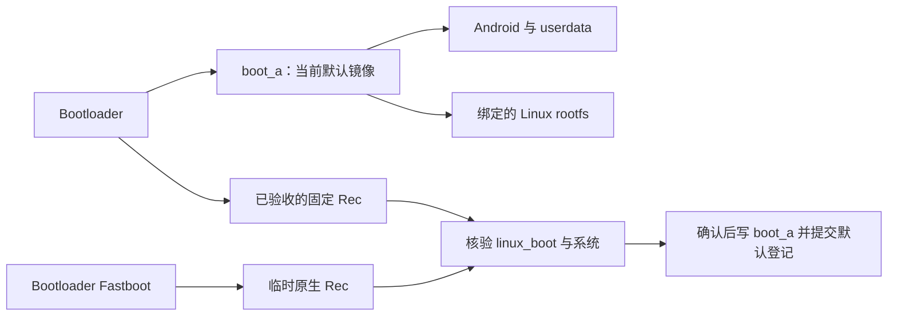

# 多系统布局与引导设计

[安装助手](INSTALLER-GUI.md) ｜ [Rec 安装后端](NATIVE-RECOVERY-INSTALLER.md)

## 范围

当前范围是一个 Android 与多个 Linux，可分次只安装 Android、只安装 Linux，或一次确认组合安装。GUI 先读取真实设备和 GPT，选定目标后才要求对应材料。运行环境统一为原生 Rec 和 USB ADB；TWRP/kexec 系统选择器不是当前依赖。

Android + ext4 Linux + Btrfs Linux 的安装、启动及默认引导切换已验证。

## 分区与身份

| 对象 | 作用 |
| --- | --- |
| userdata、metadata | Android 数据与加密初始化；完整重装会清空，不作为 Linux /home |
| 一个或多个 rootfs | 每个 Linux 独立的 ext4/Btrfs 根系统；/home 默认位于其中 |
| linux_boot | 多系统登记、各版本引导镜像、事务与恢复材料；不作为 Linux 根系统 |
| boot_a | 当前默认系统的完整启动镜像；多个 Linux 不需要多个物理 boot 分区 |
| recovery_a | 固定 Rec 的独立启动入口，按设备与固件绑定；固定保护另有资格与作用范围 |
| super 与 A 槽启动/固件资源 | Android 完整 ROM 按包处理的共享资源；不容纳本项目 Linux rootfs |

系统使用稳定 UUID。rootfs GPT 名称为 `lqr_` 加 12 位 ID，共 16 ASCII 字节；显示名称可以相同或使用中文。真正的定位依据是 PARTUUID、文件系统 UUID、系统身份和绑定的引导代次，不只靠分区标签。

同一发行版可安装多份，每个新 rootfs 生成新身份。重装既有 rootfs 重新核对目标和格式化后的文件系统身份；其他系统、边界和引导文件保留。旧超长 GPT 名称只读诊断，不自动更名。

单 Android 布局不强制创建 linux_boot。出现受管理的 Linux/多系统布局后，由分区规划器创建或复用引导存储。容量需要计入系统镜像、旧 boot 快照、事务暂存与余量，不能承诺任意系统数量都只需 2 GiB。

## 先分区、后按需安装

1. 读取实际 GPT、全部原有分区身份和登记，计算真实空闲区。
2. 新建、删除、格式化只加入操作列表；选中 userdata/rootfs 才分别要求 ROM/Linux 材料。
3. 准备阶段检查所有材料、主机/RAM/linux_boot 空间、旧默认引导及设备备份。
4. 一次确认完整方案，才编辑 GPT/文件系统并安装系统；布局改变后另存新布局备份。
5. 所选系统完成回读和登记后，最后写入最终默认引导。结束留在 Rec。

新分区只使用 GPT 空闲区和本次明确删除所释放的空间。不保留数据缩容、不移动相邻分区；「使用所有未分配空间」选择最大连续区间，计入引导存储和对齐。Android 设置中的剩余空间不是 GPT 空闲区。

删除/格式化所选 rootfs 会取消其旧登记并清除对应内容；未选中不代表能抵消已明确排队的删除操作。重装或移除当前默认系统时需选定有效的新默认引导，不能凭恢复旧 boot 保证已清除系统仍可启动。

## 默认启动与切换



普通开机直接走当前 boot_a；不会先自动显示 Rec 系统菜单。切换由电脑 GUI 的「默认启动系统」或带 `tablet_boot_switch_version=1` 的 Rec 系统列表发起。

切换计划绑定当前 boot、分区和整个引导存储快照。先保存旧 boot/登记，核验目标镜像、Linux 根绑定或 Android 安装记录/ROM，再完整写入和回读 boot_a，最后提交默认字段。仅开放 boot_a 与 linux_boot，不格式化系统根分区、不写 B 槽。

Android 安装后另行固定过 Rec 时，恢复/切换可使用设备绑定的固定镜像作为 recovery_a 的独立依据。设备序列号、目标和摘要必须匹配，其他 ROM/固件检查仍保留。

## 引导存储

```text
registry.json
SHA256SUMS
systems/<os_id>/images/<generation>.img
transactions/android-<transaction>/...
transactions/linux-<transaction>/...
transactions/switch-<transaction>/...
transactions/edit-<transaction>/...
```

登记同时描述已安装系统与预留 rootfs。预留分区不假装已经装好系统。系统条目、目标根身份和 boot 代次一起校验；提交使用原子文件替换和持久化记录，不能只凭一个“完成”标志决定可启动。

引导与旧 boot 快照可用稀疏文件保存，逻辑长度、零填充结果和整分区 SHA256 保持不变。空间统计使用实际分配块。

`boot_store_version=1` 提供独立检查和清理预览。`boot_store_retention_version=1` 在整份安装或切换计划成功后，保留现用系统及有限回退材料，回收过期引导和等价快照；默认不沿历史计划保留整条版本链。默认引导不匹配或有待处理事务时停止普通清理，续接清理需核验原计划。完整策略见[安装后端](NATIVE-RECOVERY-INSTALLER.md#中断恢复与空间回收)。

## Android 与 Linux 的保护边界

Android 完整重装更新包内系统、A 槽启动资源/固件及数据初始化；启用且通过固定 Rec 保护时跳过 ROM 内 Recovery，否则按包处理。旧 rootfs 和 linux_boot 不作为 ROM 镜像写入目标，但共享固件改变后旧 Linux/Rec 的下次启动兼容性仍需验证。

多系统 Linux 安装只格式化选定目标，将 boot 绑定其根身份后登记。Android 和其他 rootfs 保持只读。所有材料先通过检查，组合执行失败时保留已完成子任务，不自动从头清除。

完整 ROM 规则见[ROM v2](FULL-ROM-FLASH.md)，固定 Rec 的保护规则见[安装后端](NATIVE-RECOVERY-INSTALLER.md)。Android data 解密未实现。

## 中断与恢复

- 引导切换：依据原计划、旧引导与登记、当前分区及文件快照，可恢复原引导；目标已完整写入时也可补交目标登记。
- 系统提交：新版持久记录与真实完成的 rootfs/ROM 都匹配后，可补交登记；不会重复解压或格式化。
- 新布局初始化：旧的受限续接只允许完全匹配、尚未初始化的全新 Linux 引导存储/rootfs，不重写 GPT。
- 其他状态：保留 Rec、执行记录和设备外备份，不自动重放原清除方案；未写完的系统不当作已安装系统。

新维护能力与 Rec 构建绑定。旧固定版不会因 GUI 更新获得它。恢复 boot、GPT 或登记均不能恢复已经被格式化的个人文件。

## 实现位置

| 层 | 主要入口 |
| --- | --- |
| 当前 GUI、统一确认 | `wizard.py`、`qml/Main.qml`、`workflow.py`、`workflow_capacity.py` |
| 主机默认切换/维护 | `boot_switch.py`、`boot_store.py` |
| 分区与登记规则 | `shared/liuqin_partitions.py`、`liuqin_partition_editor.py`、`liuqin_managed.py` |
| 根绑定与引导接口 | `shared/liuqin_boot_target.py`、`device/boot/boot-target-v1.sh` |
| 设备安装/分区事务 | `device/installer/android-device.py` |
| Rec 会话、切换、维护 | `shared/liuqin_native_install.py`、`device/recovery/native-install.py`、`native-store.py` |

底层首次布局/单根兼容协议由引擎及设备测试维护；日常使用不需要先选择这些底层模式。
